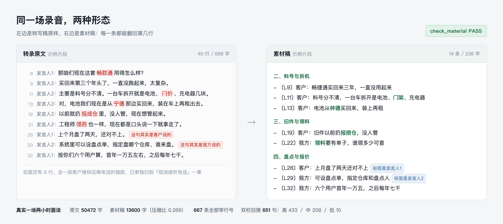

# 录音转素材稿（transcript-to-facts）

把一场几万字、说话人标签还乱掉的会议录音，整理成一份**每条都带〔L行号〕、可以回原文核对**的事实稿。然后拿这份稿子去写任何成品（客户纪要、CRM 跟进记录、方案）。

它不生成纪要。它只负责让纪要里每一句话都能指回录音的第几行。



> 上图在 `raw.githubusercontent.com` 不可达的网络下会裂（国内直连经常这样）。图里讲的事，下面用文字再说一遍：

```
转录原文（原样，40 行里的几行）

  发言人1：那咱们现在这套畅联通用得怎么样？
  发言人2：主要是料号分不清。一台车拆开就是电池、门价、充电器几块。
  发言人2：电池我们现在是从宁德那边买回来，装在车上再租出去。
  发言人1：上个月盘了两天，还对不上。          ← 标签是发言人1，这句其实是客户说的
  发言人2：系统里可以设盘点单，指定盘哪个仓库。  ← 标签是发言人2，这句其实是我方说的


整理成素材稿（14 条 / 238 字，每条都带行号）

  二、料号与拆机
  - 〔L9〕客户：畅捷通买回来三年，一直没用起来
  - 〔L11〕客户：料号分不清，一台车拆开是电池、门架、充电器
  - 〔L13〕客户：电池从林德买回来，装上再租

  四、盘点与报价
  - 〔L28〕客户：上月盘了两天还对不上
  - 〔L29〕我方：可设盘点单，指定仓库和盘点人
```

改动有五处：畅联通→畅捷通、门价→门架、宁德→林德、报成仓→报损仓、领药→领料，加上 L28/L29 两句的说话人按内容纠正。

---

## 为什么要有这一步

一场两小时的会面，转写出来四五万字。直接丢给模型"总结成会议纪要"，会稳定出现四种错：

| 你看到的现象 | 真实原因 |
|---|---|
| 纪要里出现客户从没说过的事 | 模型填不满结构就会编。四万字压成两页，缺的部分只能补 |
| 同一个人的话，前后挂在两个人头上 | 说话人分离在分段提交时每段独立聚类，`speaker_id` 从 0 重排，整段对调。极端情况下**一行里塞了两个人在说** |
| 客户名、产品名、金额被音近字污染 | ASR 没喂热词。"畅捷通"被听成"畅联通"，后面所有环节跟着错 |
| 后半场某个话题整个消失 | 长文注意力漂移，模型只记得开头和结尾 |

这四种错，靠"请勿编造"这种提示词是拦不住的。所以换个做法：先把事实抽成带行号的清单，再拿清单去写。

写成品的人拿不到原文，就编不出原文没有的东西。

---

## 三道门禁，全部机器判定

想法谁都有，"能不能自证"是另一回事。这个工具链有三道门禁，每一道都输出可复核的数字。

**第一道：素材稿门禁**（`tools/check_material.py`）

```
══ check_material
   原文 482 行 / 50472 汉字
   素材 13600 汉字 → 压缩比 0.269
   分项：客户270  我方372  第三方11  归属存疑14  听不清1
  [1] 覆盖声明 ✓
  [2] 行号锚点 ✓ 667 条全有〔L号〕
  [3] 行号未越界 ✓
  [4] 压缩比 ✓ 0.27 在 0.18–0.36
  [5] 术语变体 ✓ 无

结论: PASS
```

压缩比低于 1/5 说明你在丢东西，高于 1/3 说明你在抄原文。术语变体（"门价"混进正文这种）直接判 FAIL。行号越界当场抓出来。

**第二道：双栏对照**（`tools/dual_view.py`）

把素材稿的每一句拿回原文里滑窗比对，输出一张表：成品句 / 原文命中行 / 相似度 / 判定。

```
✓433  ？208  ✗10   共 651 句
```

这张表是给客户看的，不是给自己看的。客户不需要信你"我们很严谨"，他自己顺着行号翻两行就能核。

判 ✗ 不等于编造，同义改写的字面分天然低。它是筛子，不是准确率。

**第三道：人工抽核**

随机抽 10 个〔L号〕回原文，逐条核对行号对不对、摘要有没有歪。脚本只能证明"这行存在"，证明不了"摘要没歪"。这一步没法自动化，也不打算自动化。

---

## 六道工序

| 工序 | 做什么 | 关键动作 |
|---|---|---|
| 0 转写 | 先喂热词再转，不然全是补丁 | 术语表四类：客户全名、参会人名、行业产品词、我方与竞品名 |
| 1 抽取 | 分块只抽不写 | 按话题或文件自带分段切块；先 `<quotes>` 逐字引原文，再 `<facts>` 只基于引文写 |
| 2 合并 | 去重、冲突保留 | 同一件事两处说法不一致，两条都留并标〔说法冲突〕，不许抹平 |
| 3 门禁 | 跑脚本 | 不 PASS 不进下一步 |
| 4 对照 | 双栏回搜 | 给客户的那份 |
| 5 人核 | 通读 + 抽 10 条 | 唯一的非机器环节 |

抽取阶段严禁总结。判断、归纳、建议一律留到下游工序。这条守不住，整个流程就退化成"用更贵的办法生成一份照样会编的纪要"。

---

## 快速开始

零依赖。Python 3，只用标准库，不需要 pip install。

```bash
git clone https://github.com/wuut475/transcript-to-facts.git
cd transcript-to-facts

# 用仓库里的合成样例跑一遍，看它会输出什么
python3 tools/check_material.py \
  --src examples/sample_transcript.txt \
  --md  examples/sample_material.md

python3 tools/dual_view.py \
  --minutes examples/sample_material.md \
  --src     examples/sample_transcript.txt \
  --out     examples/sample_dual_view.md
```

换成自己的文件就能用。术语表如果不想改代码，用 `--terms 词表.txt` 传，每行写 `正确词=错1,错2`。

给 AI 助手（Claude Code、Cursor、自己的 agent）用的时候，把 `SKILL.md` 丢进它的 skills 目录，`references/prompts.md` 里是抽取和组装的完整提示词模板。

---

## 实测数字

一场真实的两小时现场面谈（叉车租赁行业，含中段一大段客户在接供应商电话）：

| 指标 | 数值 |
|---|---|
| 转录原文 | 482 行 / 50,472 汉字 |
| 素材稿 | 35 个话题 / 667 条 / 13,600 汉字 |
| 压缩比 | 0.269 |
| 双栏对照 | 651 句，✓433 ／？208 ／✗10 |
| 人工抽核 | 10 条行号全对，2 条摘要偏压缩 |
| 抽取期间标〔归属存疑〕 | 14 条 |

耗时主要在转写和抽取，门禁和对照是秒级。

---

## 目录结构

```
transcript-to-facts/
├── SKILL.md                     完整流程说明（给人和给 AI 都读这份）
├── references/prompts.md        抽取 / 组装 / 自查的提示词模板，直接粘
├── tools/check_material.py      素材稿门禁，退出码 0=PASS 1=FAIL
├── tools/dual_view.py           双栏对照
├── examples/                    合成样例，不含任何真实客户
│   ├── sample_transcript.txt    40 行转录，故意留了音近错字和标签对调
│   ├── sample_material.md       对应素材稿
│   └── sample_dual_view.md      对照表输出
└── assets/compare.png           效果图
```

`examples/` 里的内容全部是编的，不对应任何真实客户、人员、金额。样例只有 40 行，所以它的压缩比（0.34）比真实长录音（0.27）偏高：短样例里的应答碎句少，比例自然高。别拿它的数值当基准。

---

## 边界

它只做事实层。出了素材稿就停手，不写纪要、不写跟进记录、不写方案。往下游走需要各自的模板和口径，那些不在本仓库。

它不修 ASR。热词要在转写那一步喂进去，转完再纠错收益很低（`pycorrector` 在 ASR 文本上实测 CER 6.343 到 6.340，还会误纠语气词）。

它也不保证归属全对。说话人标签错得厉害时，一部分条目只能是〔归属存疑〕。这类条目要人工确认，不许静默假设。

---

## 依据

Anthropic 的 "Ground responses in quotes"（先引后结）｜SummHay 实测纯长上下文 joint score 低于 20%（人类 56%）｜Lost in the Middle（中段被顺掉）｜证据对象设计参考 GitHub `minutes`｜术语表流水线参考 `oral-interview-transcription-skill`｜伪决策与归错人参考 `cn-skills/meeting-notes`｜防漏纪律参考 `daymade/meeting-minutes-taker`（三路并行 UNION）。

## 许可

MIT。
